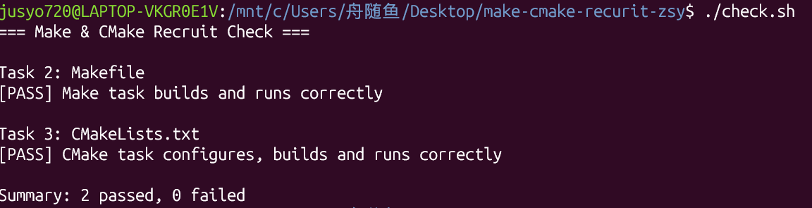

# Task 4：思考题

## 1. Make 和简单的 build.sh 有什么区别？

`build.sh`会将所有的`.c`文件重新编译一遍，效率低；`Make`则会更具编写的Makefile规则检查源文件是否发生变动,若无变动，那么Make会直接跳过该文件而只编译改动了的源文件，提高了效率。

## 2. CMake 是编译器吗？

执行 `cmake --build build` 时，最终是谁在编译 C 源文件？

CMake不是编译器，只负责生成Makefile。
是原本的编译器gcc在编译源文件。

## 3. 为什么不希望每次都重新编译所有 `.c` 文件？

节省时间和内存，提高效率。  

